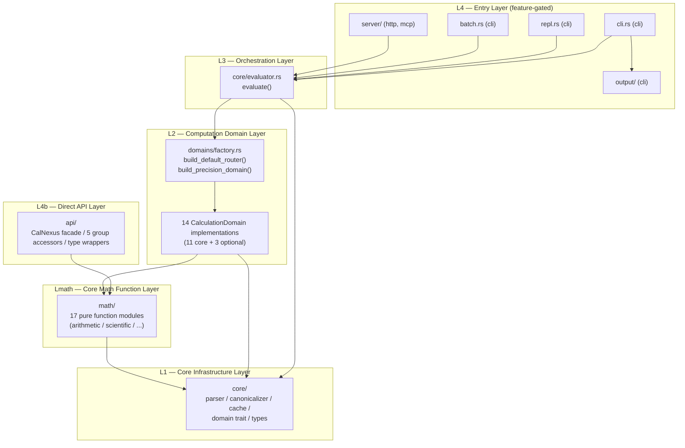
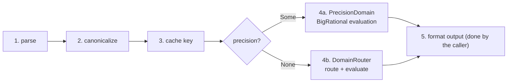
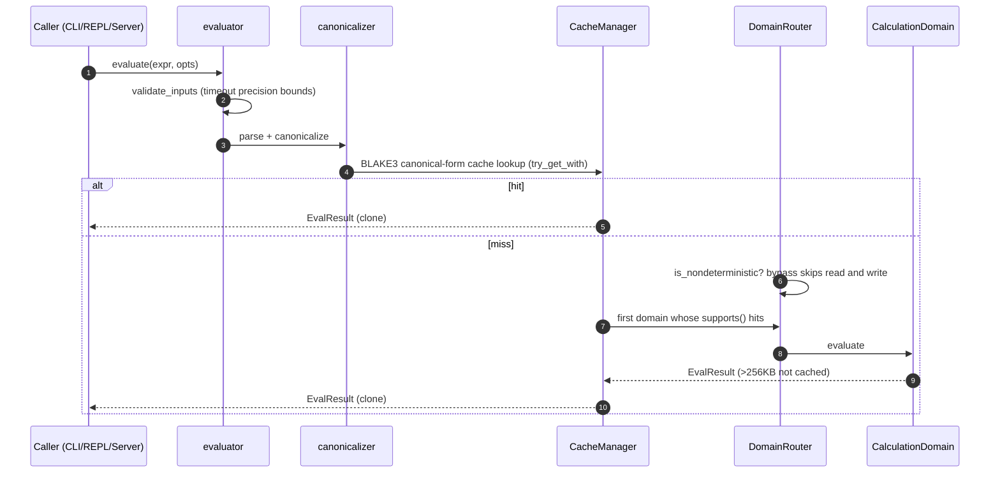
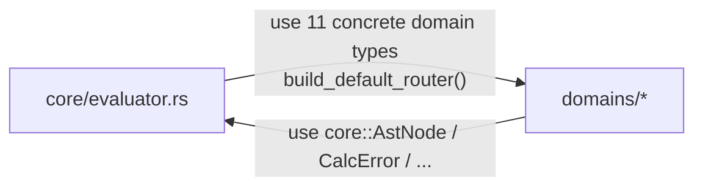
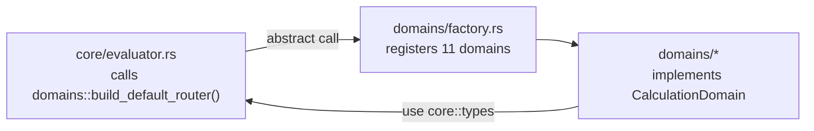
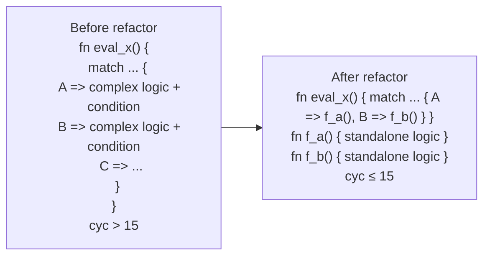

# 🏗️ CalNexus Architecture

> This document describes CalNexus's design principles, module layout, dependency direction, and data flow.
> Source code prevails over this document; the document is updated after every architecture change. Historical governance records are in the appendices.

## 📋 Table of Contents

- [🎯 Overview](#-overview)
- [📐 Design Principles](#-design-principles)
- [🏛️ System Architecture](#-system-architecture)
- [🧩 Module Layout](#-module-layout)
  - [L1 — Core Infrastructure Layer](#l1--core-infrastructure-layer-srccore)
  - [Lmath — Core Math Function Layer](#lmath--core-math-function-layer-srcmath)
  - [L2 — Computation Domain Layer](#l2--computation-domain-layer-srcdomains)
  - [L3 — Orchestration Layer](#l3--orchestration-layer-srccoreevaluatorrs)
  - [L4b — Direct API Layer](#l4b--direct-api-layer-srcapi)
  - [L4 — Entry Layer](#l4--entry-layer)
  - [Repository Directory Structure](#repository-directory-structure)
  - [Feature Gate Strategy](#feature-gate-strategy)
- [🌊 Data Flow](#-data-flow)
- [🔒 Security Design](#-security-design)
- [⚡ Performance Design](#-performance-design)
- [🧭 Architecture Decision Records (ADR)](#-architecture-decision-records-adr)
- [📚 Related Documents](#-related-documents)
- [Appendix A: Circular Dependency Fix Strategy (P2)](#appendix-a-circular-dependency-fix-strategy-p2)
- [Appendix B: Complexity Governance (P2)](#appendix-b-complexity-governance-p2)
- [Appendix C: v0.1.5 Architecture Change Record](#appendix-c-v015-architecture-change-record)
- [🎨 Feature Flags Quick Reference](#-feature-flags-quick-reference)
- [🌟 Core Dependencies](#-core-dependencies)

---

## 🎯 Overview

CalNexus is a command-line math expression evaluator: 11 core computation domains + 3 optional computation domains unified behind a single parser and a priority-routed domain dispatcher, exposing single-expression / REPL / batch CLI forms and HTTP / MCP dual-protocol services upward, and supporting embedded integration as a zero-dependency core library downward.

---

## 📐 Design Principles

- **Iron law of dependency direction**: five layers, dependencies strictly top-down, lower layers unaware of upper layers; the direct API path `api/` → `math/` → `core/` does not go through domain routing.
- **Single orchestration entry**: `evaluate()` in `core/evaluator.rs` is the only top-level evaluation entry, orchestrating the five stages parse → canonicalize → cache → route → evaluate.
- **Rule 25 (mod.rs discipline)**: all `mod.rs` files contain only `mod` declarations, `pub use` re-exports, and type definitions; implementation functions are always split into standalone files (e.g. `domains/factory.rs`, `api/scalar.rs`).
- **Function catalog**: the unified function catalog `function_catalog` is consumed by REPL completion, `--list-functions`, and the MCP `list_functions` tool; the catalog is a display list — actual evaluability follows each domain's whitelist. HTTP routes are mounted explicitly via `build_router()`.
- **Feature gating**: optional capabilities (CLI, server, optional domains, numerical decompositions, internationalization) are independent features; with `default = []` the core library has zero dependencies and can be used as an embedded engine.
- **Decoupling of core and external dependencies**: caching is based on oxcache `ByteWeightCache` (moka kernel), parsing on mathexpr; all dependencies disable default features and enable only what is needed.

---

## 🏛️ System Architecture

---

## 🧩 Module Layout

### L1 — Core Infrastructure Layer (`src/core/`)

Shared infrastructure with no business logic, used by all upper layers:

| Module | Responsibility |
|------|------|
| `types.rs` | Shared types: `AstNode` / `BinaryOp` / `UnaryOp` / `CalcError` / `EvalResult` / `Span` etc. |
| `parser.rs` | Expression string → `AstNode` (recursive-descent parser) |
| `canonicalizer.rs` | AST canonicalization (commutative sorting + constant folding + unary normalization) + S-expression serialization |
| `cache.rs` | L1 cache manager (based on oxcache `ByteWeightCache`, moka kernel: try_get_with single-flight, byte-weight budget, clone-on-hit (serialization-free); single-pass BLAKE3 keys) |
| `domain.rs` | `CalculationDomain` trait + `DomainRouter` (priority routing over 14 domains) |
| `evaluator.rs` | Top-level `evaluate()` orchestration function (parse → canonicalize → cache → route → evaluate) — **L3 orchestration layer**, located under `src/core/` |

### Lmath — Core Math Function Layer (`src/math/`)

A collection of pure math functions extracted from the domain layer, with no expression-parsing/domain-routing dependencies. 17 modules (18 files) corresponding to the mathematical cores of the computation domains:

| Module | Responsibility |
|------|------|
| `arithmetic.rs` | Four arithmetic operations + power + modulo + factorial + absolute value |
| `scientific.rs` | Trig/hyperbolic/exponential/log/special functions (gamma/erf) |
| `statistics.rs` | mean/variance/std/median + distribution/testing/correlation functions |
| `number_theory.rs` | GCD/LCM/primality/prime sieve/modular inverse/modular exponentiation/Euler's totient |
| `combinatorics.rs` | Permutations/combinations/Catalan/Stirling |
| `matrix.rs` | det/inverse/transpose/identity/mat_mul (nalgebra DMatrix) |
| `vector.rs` | dot/cross/normalize/magnitude |
| `complex.rs` | Complex arithmetic/modulus/argument/conjugate/complex exp/complex ln |
| `polynomial.rs` | poly_add/sub/mul/div/roots/eval |
| `symbolic.rs` | Symbolic differentiation/integration/simplification/limits/Taylor expansion |
| `precision.rs` | BigRational evaluation + format_bigrational |
| `solvers.rs` | Newton-Raphson / bisection / Brent numerical equation solving |
| `numerical.rs` | eig/SVD/LU/QR/solve/matrix_exp (feature = "numerical", nalgebra) |
| `time.rs` | now/today/date_add/date_diff/parse_date (feature = "time") |
| `unit.rs` + `unit_table.rs` | 8-dimension unit conversion + affine temperature (feature = "unit") |
| `fx.rs` | FX conversion RateTable + convert/get_rate (feature = "fx") |

**Dependency direction**: `math/` → `core/` (types only), never `domains/`.

### L2 — Computation Domain Layer (`src/domains/`)

11 core computation domains + 3 optional computation domains (feature-gated); each domain implements the `CalculationDomain` trait and handles a specific class of math operations (listed by ascending priority; higher priority matches first):

| Domain | priority | Feature | Operations covered |
|----|----------|---------|----------|
| `ArithmeticDomain` | 10 | — | Basic arithmetic + power + modulo |
| `ScientificDomain` | 20 | — | Trig/hyperbolic/exponential/log/special functions |
| `StatisticsDomain` | 20 | — | Statistics functions |
| `NumberTheoryDomain` | 25 | — | Number theory (GCD/LCM/primality/sieve/modular inverse/modular exponentiation/Euler's totient) |
| `CombinatoricsDomain` | 25 | — | Permutations/combinations/Catalan/Stirling |
| `PolynomialDomain` | 25 | — | Polynomial operations |
| `PrecisionDomain` | 25 | — | BigRational high-precision evaluation (bypasses the router) |
| `ComplexDomain` | 30 | — | Complex number operations |
| `MatrixDomain` | 30 | — | Matrix operations (nalgebra) |
| `VectorDomain` | 30 | — | Vector operations |
| `SymbolicDomain` | 30 | — | Symbolic differentiation/integration/simplification/limits/Taylor |
| `TimeDomain` | 30 | `time` | Date/time construction, interval arithmetic, multi-format parsing (jiff 0.2 + IANA tzdb) |
| `UnitDomain` | 30 | `unit` | 8-dimension physical unit conversion + affine temperature |
| `FxDomain` | 30 | `fx` | FX conversion (frankfurter / ExchangeRate-API dual sources + 3-level cache; `CALNEXUS_FX_PROVIDER` with three values) |

**Factory functions** live in `domains/factory.rs` (Rule 25 compliant: `mod.rs` contains only declarations and re-exports):

- `build_default_router()` — registers all 14 domains (including feature-gated optional domains) into `DomainRouter`
- `build_precision_domain()` — constructs a `PrecisionDomain` instance (for the precision mode in `evaluator.rs`)

### L3 — Orchestration Layer (`src/core/evaluator.rs`)

`evaluate()` is the only top-level entry, orchestrating the five-stage pipeline:

**Nondeterministic function cache bypass (R-ncb-003)**: in regular mode, `eval_regular_mode` calls `DomainRouter::is_nondeterministic(canonical_ast)` before routing to detect whether the AST contains nondeterministic functions such as `now` / `today` / `fx` / `fx_rate`. On a hit, **both** `cache.get` and `cache.insert` are skipped, preventing time/fx results from polluting the cache. Detection costs a HashSet lookup, O(AST node count).

### L4b — Direct API Layer (`src/api/`)

The `CalNexus` facade struct provides a direct API entry that bypasses expression parsing, for embedded/programmatic call scenarios:

| Component | Responsibility |
|------|------|
| `mod.rs` | `CalNexus` facade (`RwLock<EvalContext>` + 5 group accessors) |
| `types.rs` | 5 type wrappers (Matrix/Vector/Complex/Polynomial/BigNumber) + From/TryFrom |
| `traits.rs` | 5 group trait definitions (ScalarMath/LinearAlgebra/DataAnalysis/SymbolicMath/AppliedMath) |
| `scalar.rs` | ScalarMathImpl — arithmetic(8) + scientific functions(14) + precision(1) + number theory(9) + combinatorics(5), 37 methods |
| `linalg.rs` | LinearAlgebraImpl — matrix(8) + vector(6) + numerical decompositions(6), 20 methods |
| `stats.rs` | DataAnalysisImpl — basic statistics(8) + distributions(16) + hypothesis tests(3) + correlation(2) + regression(3), 32 methods |
| `symbolic_api.rs` | SymbolicMathImpl — symbolic calculus(5) + polynomial(6) + complex(9) + equation solving(1), 21 methods |
| `applied.rs` | AppliedMathImpl — time(13) + unit(1) + fx(2), 16 methods (feature-gated) |

**Dependency direction**: `api/` → `math/` → `core/`, never `domains/`.

### L4 — Entry Layer

- **CLI** (`src/cli.rs`): clap command-line entry with the `--latex`/`--steps`/`--canonical`/`--json`/`--precision` flags
- **REPL** (`src/repl.rs`): rustyline interactive evaluation
- **Batch** (`src/batch.rs`): batch file evaluation
- **Server** (`src/server/`): HTTP + MCP dual-protocol services, declaratively wrapped with `#[forge]` (sdforge) — a single async fn generates both the HTTP `POST /api/v1/evaluate` route and the MCP `evaluate` tool, with error responses unified under the `ApiError` contract (`InvalidInput`→400 / `ValidationError`→422 / `ServiceUnavailable`→503; the HTTP body renders as the sdforge UnifiedError `{code,message,trace_id?,field?}`, while MCP keeps `ApiError` serialization). The module contains: `evaluate.rs` (the `#[forge]` entry), `http.rs` (HTTP startup + graceful shutdown), `mcp.rs` (MCP stdio startup), `types.rs` (request/response DTOs + vars validation), `cache.rs` (shared server cache), `ratelimit.rs` (fixed-window rate limiting, `ratelimit` feature)
- **Output** (`src/output/`): three formatters for LaTeX / steps / canonical form

### Repository Directory Structure

| Directory | Contents |
|------|------|
| `tests/` | Integration tests: integration, cli_integration (assert_cmd), repl_integration (expectrl), server_http_integration, server_mcp_integration, property_tests (proptest), snapshot_tests (insta), security_tests, api_integration, time_unit_fx_integration, common/ (shared utilities) |
| `benches/` | Criterion benchmarks: cache_bench, parser_bench, domain_bench, api_bench (each file self-contained, no shared code) |
| `fuzz/` | 7 cargo-fuzz targets: parser, ast_depth, list_depth, canonicalizer, cache_key, numeric_boundary, matrix_dim |
| `docs/` | This document set and the JSON Schema (`schema/result-v1.json`) |

### Feature Gate Strategy

| Feature | Modules enabled | Purpose |
|---------|----------|------|
| `cli` | `cli.rs` / `repl.rs` / `batch.rs` / `output/` | Command-line interaction |
| `http` | `server/http.rs` | HTTP API |
| `mcp` | `server/mcp.rs` | MCP tool |
| `server` | `http` + `mcp` | Aggregate feature |
| `icu` | ICU4X internationalization | Localized error messages |
| `time` | `domains/time.rs` | Time computations (jiff 0.2 + IANA tzdb, 14 functions) |
| `unit` | `math/unit.rs` / `math/unit_table.rs` → `domains/unit.rs` | 8-dimension physical unit conversion + affine temperature |
| `fx` | `math/fx.rs` → `domains/fx.rs` / `fx_provider.rs` | FX conversion (frankfurter / er-api dual sources, `auto` failover, 3-level cache + network circuit breaker) |
| `numerical` | `math/numerical.rs` → `domains/numerical.rs` + `api/linalg.rs` | Numerical linear algebra decompositions (eig/SVD/LU/QR/solve/matrix_exp, nalgebra f64) |
| `ratelimit` | `server/ratelimit.rs` | HTTP rate limiting (sdforge ratelimit-http contract) |
| `docs` | sdforge/docs | OpenAPI + Swagger UI |
| `observability` | inklog `LoggerManager` | Structured logging (RUST_LOG) |

`default = []`: the core library has zero dependencies and can be referenced by other crates as an embedded computation engine.

---

## 🌊 Data Flow

### Evaluation main flow

### Cache single-flight data flow

Concurrent requests for the same expression converge at `try_get_with`: the first request performs the real evaluation and writes the cache, and every other waiter gets its own clone of the same cached value; if the evaluation fails, the error propagates as-is to all waiters and does not pollute the cache.

### Server-mode data flow

The evaluation entry declared with `#[forge]` generates both an HTTP route and an MCP tool; HTTP routes are mounted explicitly by `build_router()` (single source of truth), pass through the context middleware injecting `X-Request-ID` / `traceparent`, then through the optional rate-limiting layer before entering the evaluator; errors map uniformly to `ApiError` (400 / 422 / 503; the HTTP body is UnifiedError `{code,message,trace_id?,field?}`), probes (`/live` `/ready` `/health`) have separated semantics, and graceful shutdown drains for at most 30s.

---

## 🔒 Security Design

- **Closed recursion-depth protection loop**: `MAX_AST_DEPTH=256` + iterative bracket pre-check before mathexpr + a thread-local RAII guard for bracket-literal recursion + a canonicalizer depth guard, closing the nested list/matrix literal bypass (a historical DoS gap, now fixed).
- **Request resource limits**: expr ≤ 4096 chars, vars ≤ 1024 keys, precision ≤ 10000 digits; `--timeout` backstops accumulated slow operations.
- **Error message sanitization**: parse errors never leak winnow's internal Debug structures; error messages are sanitized through the i18n layer.
- **fx upstream hardening**: ureq `https_only`, 1MB response-body cap, atomic disk-cache writes (temp+rename+0600), fetch single-flight, three-state network circuit breaker.
- **Error semantics tiering**: `DependencyUnavailable` (503) is strictly distinguished from client input errors (400), SLO-friendly.

For security configuration best practices and the vulnerability handling process, see [🔒 Security](SECURITY.md).

---

## ⚡ Performance Design

- **Low overhead on the cache hot path**: hits return a clone of `EvalResult`, with no serialization and no temporary runtime; single-flight eliminates concurrent duplicate evaluations.
- **Bounded cache**: byte-weight budget (64MB default) + 256KB large-result admission threshold.
- **Cheap key construction**: a single BLAKE3 hash over the canonical S-expression; the canonicalizer runs in sub-microseconds (benchmarks in the [📈 Performance Guide](PERFORMANCE.md)).
- **Compile-time trimming**: all optional capabilities are feature-gated, controlling build time and binary size; dependencies disable default features.

---

## 🧭 Architecture Decision Records (ADR)

> Decision records originating from the former architecture design document (ADD, archived to `docs/archive/`), revised to reflect the current ADR state.

| ID | Decision | Status | Context | Decision | Consequences | Date |
|--------|----------|:----:|--------|------|------|------|
| **ADR-001** | In-process L1-only cache | ✅ Adopted (revised in v0.1.5) | No Redis in library scenarios; an in-process cache suffices | Moka only, TTL = process lifetime | No cross-process sharing, but zero ops | 2026-06-28 |
| **ADR-002** | Unified trait interface | ✅ Adopted | 14 computation domains need standardized integration | CalculationDomain trait | Low learning cost, high extensibility | 2026-06-28 |
| **ADR-003** | AST canonicalization dedup | ✅ Adopted | `3+2` and `2+3` must share a cache entry | Commutative sorting + constant folding | Canonicalization overhead is sub-microsecond (measured 45~430 ns in v0.1.5), acceptable | 2026-06-28 |
| **ADR-004** | mathexpr parser | ✅ Adopted | Need a safe, high-performance expression parser | mathexpr or an in-house Pratt parser | No complex/matrix support; needs extension | 2026-06-28 |
| **ADR-005** | Built-in symbolic computation engine | ✅ Adopted | rssn community controversy + pivot to FFI | In-house symbolic computation implementation | No third-party dependency risk | 2026-06-28 |
| **ADR-006** | Single-crate layered architecture | ✅ Adopted | Library and CLI released together | Single crate + layered modules (core/domains/math/api) | Simpler builds, lower complexity | 2026-06-28 |
| **ADR-007** | fx cache decorator separated from fetch implementation (design D1) | ✅ Adopted | A single provider handled caching/breaker/stale/fetch, blocking a second source | `CachedRateProvider` wraps `Box<dyn RateProvider>`; cache and breaker apply to the whole chain once | New sources only implement pure fetching; at most one real fetch per TTL | 2026-10-28 |
| **ADR-008** | Single env var, three-value source selection (design D4) | ✅ Adopted | Need 160+ currency coverage while keeping the ECB preference | `CALNEXUS_FX_PROVIDER`=`frankfurter`/`erapi`/`auto`; invalid values fall back to `frankfurter`; `auto` uses a fixed chain | Better coverage; minimal configuration surface; aggregated errors on total failure ease debugging | 2026-10-28 |
| **ADR-009** | Fixed chain order and observable provenance (design D7) | ✅ Adopted | Different sources show systematic same-day differences; silent mixing is forbidden | No memory of the last successful source; each TTL retries from the primary; `RateTable.source` participates in caching and responses | Results within a failover window are explicitly marked as the fallback source's basis; downstream can audit mixed sources | 2026-10-28 |

### ADR-001: In-process L1-only cache (v0.1.5 revision)

**Context**: v0.1 used a two-level cache (L1 Moka + L2 Redis) for microservice sharing. v0.2 was refactored into a single-process library + CLI with no Redis dependency, so no cross-process cache sharing is needed. Candidates: L1+L2 (high complexity, pointless in library scenarios), L1-only (simple, zero dependencies), no cache (poor performance).

**Decision**: L1-only in-process cache. Rationale: in library scenarios sharing a cache across processes is pointless; AST canonicalization dedup already delivers a high hit rate; removing Redis achieves zero ops.

**Revision (v0.1.5)**: the cache mechanics (`try_get_with` single-flight, byte-weight budget, clone-on-hit) are now provided by oxcache `ByteWeightCache` (moka kernel) — see Appendix C item 1 and the note that follows it. The decision itself (L1-only) is unchanged.

### ADR-005: Built-in symbolic computation engine

**Context**: rssn drew community controversy (unclear maintenance direction) and pivoted to FFI, violating the pure-Rust cross-platform compilation goal. Candidates: in-house implementation, symbolica (commercial license), symb_anafis (no integration/limits).

**Decision**: built-in symbolic computation engine. Rationale: pure Rust, no C FFI drag, full control over symbolic logic; covers symbolic differentiation/integration/simplification/limits/Taylor expansion. Consequence: the engine is maintained in-house, with scope limited to undergraduate-level math; advanced symbolic computation can be added via features.

### ADR-006: Single-crate layered architecture

**Context**: the project ships both a Rust library and a CLI binary, with feature gates controlling optional modules.

**Decision**: single crate + layered modules (`core/`, `math/`, `domains/`, `api/`, `cli.rs`, `repl.rs`, `batch.rs`, `server/`, `output/`). Rationale: a single crate simplifies build and release; feature gates guarantee that `cargo add calnexus` pulls no CLI dependencies; layering keeps dependency direction clear. Consequence: all modules share one version number, and layering rules are enforced by code review (the mod.rs discipline).

### ADR-007: fx cache decorator separated from fetch implementation (design D1)

**Context**: the original `FrankfurterProvider` carried five responsibilities at once — L1/L2 cache, breaker, stale policy, and network fetch — so adding a second source meant copying the entire cache stack (DRY violation + per-source fetching).

**Decision**: extract the `CachedRateProvider` decorator (`inner: Box<dyn RateProvider>`); caching/breaker/stale move up as a whole; `FrankfurterProvider` / `ExchangeRateApiProvider` shrink into stateless pure fetchers; `auto`'s `ChainRateProvider` sits inside the decorator, so cache and breaker apply to the whole chain exactly once. Rationale: preserve the "at most one real fetch per TTL" quota semantics; a new source needs only ~60 lines of fetch and parse code. Consequence: worst-case chain latency is the sum of per-source timeouts (see the capacity guardrail checklist in README).

### ADR-008: Single environment variable, three-value source selection (design D4)

**Context**: need 160+ currency coverage while keeping the ECB basis preference; list-style configuration would expose chain-order decisions to users and be hard to test.

**Decision**: three values for `CALNEXUS_FX_PROVIDER`: unset/`frankfurter` → frankfurter only (byte-for-byte compatible with the old behavior), `erapi` → ExchangeRate-API only, `auto` → fixed chain `[frankfurter, erapi]`; invalid values fall back to `frankfurter`. When both sources fail the error aggregates, listing `<provider>: <cause>` per item, and falls through to the existing stale policy. Consequence: minimal configuration surface; the chain order is fixed in code and users cannot reorder it.

### ADR-009: Fixed chain order and auditable source mixing (design D7)

**Context**: measured on the same day, USD→CNY was 6.6702 on the ECB basis and 6.684864 on the aggregated source; silent mixing would make downstream value jumps inexplicable.

**Decision**: `auto` does not "sticky-remember the last successful source" — within one TTL window results normally come from a single source, and after a failover the next window retries from the primary; `RateTable.source` is written into cache format v2 (v1 files missing `source` are judged `Corrupted` and re-fetched for self-healing), and the server's `fx_budget` / `fx_pricing` responses always carry `rate_source`. Consequence: results within a primary-source outage window are explicitly marked as the fallback basis, and source mixing is auditable; the expression-level `fx()` / `fx_rate()` keep the scalar contract and do not carry provenance.

---

## 📚 Related Documents

- [Changelog](CHANGELOG.md)
- [Contributing Guide](CONTRIBUTING.md)
- [User Guide](USER_GUIDE.md) · [API Reference](API_REFERENCE.md) · [Performance Guide](PERFORMANCE.md) · [Security](SECURITY.md) · [Server Guide](SERVER.md)

---

## Appendix A: Circular Dependency Fix Strategy (P2)

### The problem before the fix

Before the fix, `src/core/evaluator.rs` carried both **orchestration duties** and **domain registration duties**, directly `use`-ing the 11 concrete domain types, creating a bidirectional `core ↔ domains` dependency:

### The fix

The **responsibility migration** strategy was adopted: registration duties moved from `core` to the `domains` layer:

1. `build_default_router()` moved from `core/evaluator.rs` to `domains/factory.rs`
2. Added the `build_precision_domain()` factory function, removing `evaluator.rs`'s direct dependency on the `PrecisionDomain` type
3. `core/evaluator.rs` now calls `crate::domains::build_default_router()` (the abstract entry)

### The result

| Metric | Before | After | Change |
|------|--------|--------|------|
| `core` → `domains` type dependencies (production + test code) | 11 | 0 | **-100%** |
| `core` → `domains` function dependencies | 1 | 2 | +1 (abstract entry unavoidable) |
| Total dependencies | 12 | 2 | **-83%** |
| Circular dependency | present | eliminated | ✓ |

> **Verification**: `grep -rn "crate::domains::.*Domain" src/core/` returns 0 matches in production code imports (2 comment lines mentioning pattern names are excluded). `core` calls the `domains` layer only through the two abstract factory entries `build_default_router()` / `build_precision_domain()`.
> Priority tests live in the `domains/factory.rs` test module (priority is a domains-layer property and should be self-tested there).

---

## Appendix B: Complexity Governance (P2)

The 5 cyclomatic-complexity hotspots identified by codenexus (cyc > 15) were refactored one by one under the TDD process (Red → Green → Commit → Verify).

### Refactoring pattern

The **dispatch-extraction pattern** was adopted: large `match` blocks with conditional branches were split into standalone methods grouped by variant/operation, turning the main function into pure dispatch:

### Results

| File | Function | cyc before | cyc after | Reduction | Methods extracted |
|------|------|-----------|-----------|------|-----------|
| `domains/combinatorics.rs` | `eval_function` | 38 | 4 | -89% | 6 |
| `domains/matrix.rs` | `eval_binary` | 25 | 4 | -84% | 4 |
| `core/evaluator.rs` | `evaluate` | 25 | 7 | -72% | 4 |
| `core/canonicalizer.rs` | `transform_inner` | 24 | 2 | -92% | 5 |
| `domains/symbolic.rs` | `eval_symbolic` | 23 | 15 | -35% | 2 |

**All extracted methods have cyc ≤ 15**; both the main functions and the extracted methods meet the complexity gate.

### Test safeguards

Every refactor followed strict TDD:

1. **Red**: first add regression tests covering all variants/branches (including boundary conditions and error paths)
2. **Green**: refactor the implementation so tests pass (behavior unchanged)
3. **Verify**: full `cargo test` suite green + `cargo clippy -D warnings` with 0 warnings + codenexus complexity re-measurement

Test scale at the time the v0.1.5 refactor completed (historical record; for the current scale see the README's "Test Scale" section, grep is authoritative): **2820 test functions (2432 lib inline + 388 integration), the CI matrix covered the six legs cli / cli,time,unit,fx / cli,server / cli,server,fx / cli,numerical / all, all green; line coverage 90.4% (llvm-cov, gate ≥90%)**.

---

## Appendix C: v0.1.5 Architecture Change Record

v015-comprehensive-optimization (2026-09):

1. **Cache engine refactoring**: the oxcache wrapper was retired and `CacheManager` connected directly to `moka::sync` — production-grade `try_get_with` single-flight (exactly one evaluation per concurrent identical key, errors propagated as-is), byte-weight budget (64MB default) + 256KB large-result admission threshold, `Arc<EvalResult>` zero-copy hits, single-pass BLAKE3 keys. This also eliminated JSON-serialized storage, the temporary tokio runtime, and hex key allocations. (Note: the current implementation provides the same mechanics via oxcache 0.5.0-rc.8 `ByteWeightCache` from crates.io, but its `get`/`get_or_compute` return cloned values — hits are clones rather than `Arc` zero-copy; all cache statements in this document follow that.)
2. **Explicit HTTP route registration**: `#[forge]` inventory registration is silently dropped by the linker GC under rlib/test binaries (production 404s), so HTTP routes are now mounted explicitly via `build_router()` (single source of truth); `#[forge]` keeps MCP tool registration and schema derivation.
3. **Closed recursion-depth protection loop**: thread-local RAII guard for bracket-literal recursion, iterative bracket pre-check before mathexpr, canonicalizer depth guard; fuzz targets cover the real depth domain.
4. **Server-grade error semantics**: `ErrorKind::DependencyUnavailable` (exit_code=3) → HTTP 503, strictly distinguished from client 400; `/ready`/`/live`/`/health` probes have separated semantics.
5. **Observability**: request-id/traceparent middleware, HTTP RED metrics delegated to sdforge metrics (`sdforge_http_requests_total{route,method,status}`), and the observability feature wired to the inklog singleton (RUST_LOG, default warn).
6. **Public API**: `evaluate_with_router` allows router injection; `pub use server::*` made explicit; math/domains annotated with internal API boundaries; unified function catalog `function_catalog` (single source of truth for REPL completion / `--list-functions` / MCP `list_functions`).
7. **Spec process**: openspec/ converged into `specmark/specs/` (27 capability domains); **specmark is the only SDD process**.
8. **sdforge base absorption (migrating hand-written infrastructure)**: graceful shutdown switched to `sdforge::http::serve_with_graceful_shutdown` + `default_shutdown_signal`; `/health` `/ready` switched to `sdforge::health::readyz_handler` (checks-array contract, cache registered via `register_async_readiness_check_fn`: spawn_blocking isolates moka maintenance + 5s timeout marks unhealthy), `/live` switched to `healthz_handler`; request identification switched to `sdforge::context::context_middleware` (+W3C traceparent extracts trace_id and writes back `X-Trace-ID`, task-local context). The `ratelimit` feature is wired: `src/server/ratelimit.rs` implements the sdforge `HttpRequestRateLimiter` contract with a fixed-window per-IP policy, mounted via a Clone bridging layer, configurable through `CALNEXUS_RATELIMIT_LIMIT/WINDOW_SECS`, with probes/metrics exempt from rate limiting.

---

## 🎨 Feature Flags Quick Reference

> This section was migrated from the README's "🎨 Feature Flags" section and serves as the reference page for feature combos and the feature matrix.

### 📦 Recommended Combos

📋 Table

| Combo | Install / features | Use case |
|-------|--------------------|----------|
| Minimal library | `cargo add calnexus` (`default = []`) | Embedded engine, zero extra deps |
| CLI | `cargo install calnexus --features cli` | Command line / REPL / batch |
| CLI + all domains | `cargo install calnexus --features cli,time,unit,fx` | Adds time / unit / fx domains |
| CLI + numerical | `cargo install calnexus --features cli,numerical` | Numerical linear algebra |
| Bilingual CLI | `cargo install calnexus --features cli,icu` | EN/ZH error messages always built in; `icu` adds standard BCP-47 locale-tag parsing |
| HTTP server | `cargo install calnexus --features server` | REST + MCP dual-protocol service |
| Production server | `cargo install calnexus --features server,ratelimit,docs,observability` | Rate limiting + Swagger UI + structured logs |
| Full | `cargo install calnexus --all-features` | Everything |

### 📋 Feature Matrix

The table below mirrors `Cargo.toml`'s `[features]` definition; `default = []`.

📋 Table

<table style="width:100%; border-collapse: collapse">
<tr><th style="text-align:left">Feature</th><th style="text-align:center">Default</th><th style="text-align:left">Description</th></tr>
<tr><td colspan="3" style="background:#F8FAFC"><b>Core library</b></td></tr>
<tr><td><code>default</code></td><td align="center">✅</td><td>Zero-dependency core: parsing, canonicalization, 14-domain routing, cache — usable as an embedded engine</td></tr>
<tr><td><code>icu</code></td><td align="center">❌</td><td>ICU4X BCP-47 locale-tag parsing (EN/ZH error messages are always available via embedded Fluent catalogs, not gated by this feature)</td></tr>
<tr><td colspan="3" style="background:#F8FAFC"><b>CLI &amp; interaction</b></td></tr>
<tr><td><code>cli</code></td><td align="center">❌</td><td>CLI / REPL / batch (clap, rustyline, rayon; enabled indirectly via sdforge/cli)</td></tr>
<tr><td colspan="3" style="background:#F8FAFC"><b>Optional computation domains</b></td></tr>
<tr><td><code>time</code></td><td align="center">❌</td><td>Time domain: jiff 0.2 with bundled IANA tzdb, 14 functions</td></tr>
<tr><td><code>unit</code></td><td align="center">❌</td><td>Physical unit conversion domain: 8 dimensions + affine temperature</td></tr>
<tr><td><code>fx</code></td><td align="center">❌</td><td>Currency conversion domain: frankfurter / ExchangeRate-API dual sources (<code>CALNEXUS_FX_PROVIDER</code>=<code>frankfurter</code>|<code>erapi</code>|<code>auto</code>) + 3-level cache + network circuit breaker</td></tr>
<tr><td><code>numerical</code></td><td align="center">❌</td><td>Numerical linear algebra decompositions (lu/qr/eig/svd/solve/matrix_exp, nalgebra f64)</td></tr>
<tr><td colspan="3" style="background:#F8FAFC"><b>Server</b></td></tr>
<tr><td><code>http</code></td><td align="center">❌</td><td>HTTP API (sdforge http/graceful/health/context, axum)</td></tr>
<tr><td><code>mcp</code></td><td align="center">❌</td><td>MCP stdio server (sdforge/mcp)</td></tr>
<tr><td><code>server</code></td><td align="center">❌</td><td>Aggregates <code>http</code> + <code>mcp</code></td></tr>
<tr><td><code>ratelimit</code></td><td align="center">❌</td><td>HTTP rate-limiting middleware (fixed window per-IP, <code>CALNEXUS_RATELIMIT_*</code> configurable, probes exempt)</td></tr>
<tr><td><code>docs</code></td><td align="center">❌</td><td>OpenAPI + Swagger UI (<code>/swagger-ui/</code>, trailing slash required; <code>/api-docs/openapi.json</code> carries an empty spec for now — see the Server Guide)</td></tr>
<tr><td><code>observability</code></td><td align="center">❌</td><td>tracing structured logs (EnvFilter consuming <code>RUST_LOG</code>)</td></tr>
</table>

### 💱 FX data sources (`fx`)

`fx` uses [frankfurter.dev](https://frankfurter.dev) by default (European Central Bank reference rates, roughly 30 major currencies); `CALNEXUS_FX_PROVIDER` switches the source:

| Value | Behavior | Rate basis |
|-------|----------|------------|
| `frankfurter` (default) | frankfurter only | ECB reference rates, roughly 30 major currencies |
| `erapi` | ExchangeRate-API open endpoint only (no key) | Aggregated source, 160+ currencies, with systematic small differences from ECB values |
| `auto` | Fixed chain `frankfurter → erapi`, first success wins | Failover only when the primary source fails; when both fail the error aggregates each cause |

Server responses from `fx_budget` / `fx_pricing` always carry a `rate_source` field, so `auto` mix-ups are auditable. The expression-level `fx()` / `fx_rate()` functions do not expose the source (scalar contract unchanged).

| Environment variable | Default | Description |
|----------------------|---------|-------------|
| `CALNEXUS_FX_PROVIDER` | `frankfurter` | Data source: `frankfurter` / `erapi` / `auto` (invalid values fall back to `frankfurter`) |
| `CALNEXUS_FX_TTL_HOURS` | 24 | FX snapshot TTL |
| `CALNEXUS_FX_ALLOW_STALE` | — | Whether to serve an expired snapshot when the network fails |
| `CALNEXUS_FX_BREAKER_THRESHOLD` | 3 | FX network circuit-breaker failure threshold |
| `CALNEXUS_FX_BREAKER_COOLDOWN_SECS` | 30 | FX circuit-breaker cooldown (seconds) |

> **Capacity guardrail checklist**: the `server` image ships without rate limiting; when exposed publicly, enable the `ratelimit` feature explicitly and set `CALNEXUS_RATELIMIT_LIMIT` / `CALNEXUS_RATELIMIT_WINDOW_SECS` for the instance capacity. Each FX upstream fetch times out after 5 seconds and the request-level guard is 30 seconds; the `auto` chain can consume two upstream timeouts in the worst case, so account for it when sizing the rate-limit window.

---

## 🌟 Core Dependencies

CalNexus stands on the shoulders of these excellent open-source projects:

📋 Table

| Dependency | Purpose |
|------------|---------|
| [mathexpr](https://crates.io/crates/mathexpr) | Expression parsing foundation |
| [oxcache](https://crates.io/crates/oxcache) | In-house high-performance cache library (`byte-weight` sync byte-weight cache, wrapping moka::sync) |
| [clap](https://github.com/clap-rs/clap) | CLI argument parsing (indirect via sdforge/cli) |
| [rustyline](https://github.com/kkawakam/rustyline) | REPL line editing and Tab completion |
| [rayon](https://github.com/rayon-rs/rayon) | Data-parallel batch evaluation |
| [jiff](https://github.com/BurntSushi/jiff) | Date/time and IANA time zones (`time` feature) |
| [nalgebra](https://github.com/dimforge/nalgebra) | Numerical linear algebra (`numerical` feature) |
| [sdforge](https://crates.io/crates/sdforge) | CLI / HTTP / MCP interface facade |
| [criterion](https://github.com/bheisler/criterion.rs) | Benchmarking |

