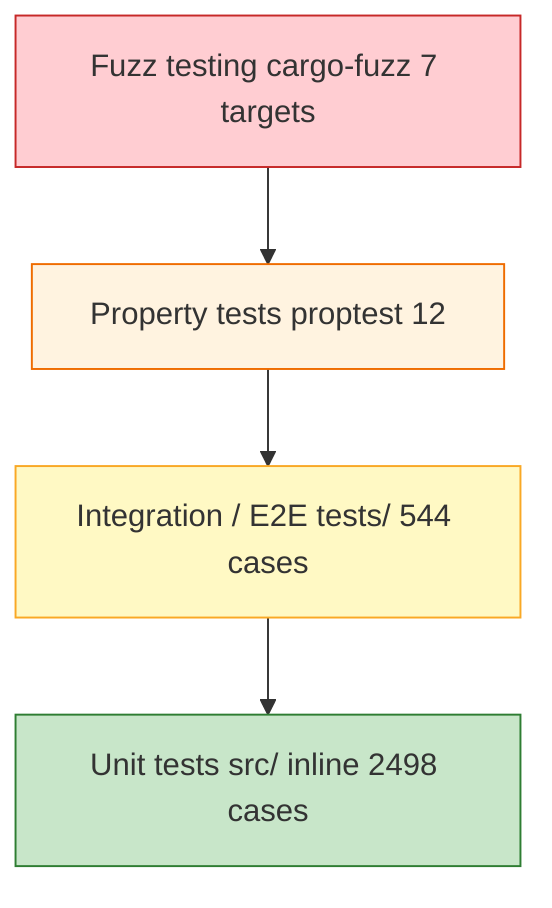

# 🧪 CalNexus Test Scenario Matrix

> Applies to: calnexus **0.1.4 + [Unreleased]** (Rust 1.97.1 / edition 2024)
> Purpose: exhaustively matrix the existing test suites as the single source of truth for regression acceptance and coverage comparison. The methodology of the former Test Plan (`docs/TEST.md` v0.2.0, 2026-06-28) that remains valid (test strategy, coverage goals, pass criteria, defect grading) has been merged into this document; the original is archived as [docs/archive/TEST.md](../archive/TEST.md).
> Written against (read-only verification): `Cargo.toml`'s `[features]` and `[[test]]` registries, inline `#[cfg(test)]` modules in `src/`, the 12 integration test files in `tests/`, the 9 scenario modules in `tests/e2e/`, the 7 `fuzz/` targets, the 4 `benches/` suites, and `.github/workflows/ci.yml`.
> All referenced test names were grep-verified to exist; count methodology: `grep -rE "#\[(tokio::)?test\]" src/ tests/ --include="*.rs" | wc -l` (**3040** as of this document's last update).

## 📋 Table of Contents

- [🎯 Reading Conventions](#-reading-conventions)
- [🗺️ Overview: Feature Domains × Test Locations](#-overview-feature-domains--test-locations)
- [🔬 Test Strategy and Coverage Goals](#-test-strategy-and-coverage-goals)
- [🧱 Unit Tests (`src/` inline, 2497)](#-unit-tests-src-inline-2497)
- [🔧 Integration Tests (`tests/`, 398)](#-integration-tests-tests-398)
  - [Core Pipeline Integration (integration.rs, 132)](#core-pipeline-integration-integrationrs-132)
  - [CLI Integration (cli_integration.rs, 133)](#cli-integration-cli_integrationrs-133)
  - [REPL Interaction Integration (repl_integration.rs, 8)](#repl-interaction-integration-repl_integrationrs-8)
  - [Facade API Integration (api_integration.rs, 17)](#facade-api-integration-api_integrationrs-17)
  - [Optional Domain Integration (time_unit_fx / numerical, 16)](#optional-domain-integration-time_unit_fx--numerical-16)
  - [Server Integration (server_http / server_mcp, 34)](#server-integration-server_http--server_mcp-34)
- [🌐 E2E Scenario Suite (`tests/e2e/`, 145)](#-e2e-scenario-suite-testse2e-145)
  - [S1 Happy Paths (happy_path.rs, 29)](#s1-happy-paths-happy_pathrs-29)
  - [S2 Boundary Conditions (edge_cases.rs, 25)](#s2-boundary-conditions-edge_casesrs-25)
  - [S3 Error Paths (error_paths.rs, 13)](#s3-error-paths-error_pathsrs-13)
  - [S4 FX Domain Offline Full Pipeline (fx_mock.rs, 14, `#[cfg(feature = "fx")]`)](#s4-fx-domain-offline-full-pipeline-fx_mockrs-14-cfgfeature--fx)
  - [S5 Feature Combination Matrix (feature_gates.rs, 17)](#s5-feature-combination-matrix-feature_gatesrs-17)
  - [S6 Cache and Routing (cache_router.rs, 18)](#s6-cache-and-routing-cache_routerrs-18)
  - [S7 Security and Robustness (security.rs, 9)](#s7-security-and-robustness-securityrs-9)
  - [S8 HTTP/MCP/ratelimit/docs (server_e2e.rs, 9, `#[cfg(feature = "server")]`)](#s8-httpmcpratelimitdocs-server_e2ers-9-cfgfeature--server)
  - [S9 CLI/Batch Gaps (cli_e2e.rs, 12, `#[cfg(feature = "cli")]`)](#s9-clibatch-gaps-cli_e2ers-12-cfgfeature--cli)
- [⚡ Property Tests (proptest, 12)](#-property-tests-proptest-12)
- [📸 Snapshot Tests (insta, 22)](#-snapshot-tests-insta-22)
- [🛡️ Security Tests (security_tests.rs, 18)](#-security-tests-security_testsrs-18)
- [⏱️ Performance Regression Tests (performance_tests.rs, 6)](#-performance-regression-tests-performance_testsrs-6)
- [🎲 Fuzz Testing (`fuzz/`, 7 targets)](#-fuzz-testing-fuzz-7-targets)
- [📈 Benchmarks (`benches/`, 4 suites)](#-benchmarks-benches-4-suites)
- [▶️ Run Commands (Matching CI)](#-run-commands-matching-ci)
- [✅ Test Pass Criteria](#-test-pass-criteria)
- [🚦 Defect Severity Levels](#-defect-severity-levels)
- [📚 Related Documents](#-related-documents)
- [📊 Test Scale (v0.2.0)](#-test-scale-v020)

---

## 🎯 Reading Conventions

- **Scenario types**: `happy` (expected behavior under valid input) / `boundary` (extreme values and critical combinations) / `error` (bad input and fault injection, must produce a clear error) / `security` (DoS and attack vectors) / `performance` (latency and regression thresholds).
- **Existing coverage**: referenced directly as `file::test_name`; all test names come from real code in the current working tree and can be grep-verified.
- **Feature gating**: the `tests/e2e/` suite has **no `required-features`** (explicitly registered via `Cargo.toml` `[[test]]`); targets compile under every feature combination, and modules internally gate both the enabled and disabled sides with `#[cfg(feature = ...)]` — `--all-features` runs the enabled side, `default` runs the disabled side.
- **Offline constraint**: the `tests/e2e/` suite makes no outbound network requests (fx uses a mock domain + tolerant smoke tests, see `tests/e2e/common/fx_mock.rs`).

---

## 🗺️ Overview: Feature Domains × Test Locations

| Layer | Location | Count | Notes |
|------|------|-----:|------|
| Unit tests | `src/core/` inline | 403 | evaluator, canonicalizer, cache, router and other core pieces |
| Unit tests | `src/domains/` inline | 1267 | 11 core domains + optional domain evaluation |
| Unit tests | `src/math/` inline | 471 | Math function layer |
| Unit tests | `src/server/` inline | 90 | http / mcp / ratelimit |
| Unit tests | `src/output/` inline | 130 | Text / JSON / LaTeX / canonical / steps output |
| Unit tests | `src/api/` inline | 12 | `CalNexus` facade and direct API |
| Unit tests | Entry layer (`src/*.rs`: main / cli / repl / batch / i18n / function_catalog / lib) | 125 | CLI parsing, REPL, batch, bilingual messages, panic-hook pipeline fallback |
| Integration tests | `tests/` (12 files, explicitly registered via `[[test]]`) | 398 | Subprocess (assert_cmd), interaction (expectrl), tower oneshot |
| E2E scenarios | `tests/e2e/` (9 scenario modules) | 146 | Five core scenario classes + cache/security/server/CLI gaps |
| Property tests | `tests/property_tests.rs` | 12 | proptest invariants |
| Snapshot tests | `tests/snapshot_tests.rs` | 22 | insta, all CLI-reachable output variants |
| Security tests | `tests/security_tests.rs` | 18 | DoS vectors and boundary attacks |
| Performance regression | `tests/performance_tests.rs` | 6 | criterion baseline comparison and thresholds |
| Total | `grep -rE "#\[(tokio::)?test\]" src/ tests/` | **3042** | Plus 7 fuzz targets, 4 criterion suites, and doctests run by `cargo test` |

> The 544 in `tests/` = 398 top-level integration + 146 E2E; the `required-features` declarations of each `[[test]]` entry are in `Cargo.toml` (e.g. `server_http_integration` needs `server`, `time_unit_fx_integration` needs `cli,time,unit,fx`).

---

## 🔬 Test Strategy and Coverage Goals



| Module category | Modules | Line coverage goal |
| :--- | :--- | :--- |
| **Core domains** | Parser, Canonicalizer, DomainRouter, Cache, Arithmetic, Scientific, NumberTheory, Combinatorics | **100%** |
| **Other domains** | Complex, Matrix, Statistics, Symbolic, Precision, Vector, Polynomial | **≥ 80%** |
| **Overall** | whole crate | **≥ 90%** (CI gate `cargo llvm-cov --fail-under-lines 90`; most recently measured 90.4%) |

- The coverage tool is **cargo-llvm-cov** (the only gate; the tarpaulin configuration was removed, see `docs/cn/CHANGELOG.md` [Unreleased] Removed).
- Strategy changes relative to v0.1 (the HTTP microservice form): removed Docker Compose / k6 / K8s load tests, returning to the Rust-native "unit + property + fuzz" trio, plus process-level CLI/REPL integration and in-process-only E2E scenario suites.

---

## 🧱 Unit Tests (`src/` inline, 2538)

Unit tests live in each module's `#[cfg(test)] mod tests` and compile with the feature gates. Per-directory statistics:

| Directory | Cases | Coverage focus |
|------|-------:|----------|
| `src/domains/` | 1267 | Function-level behavior of the 11 core domains + time/unit/fx/numerical domains, error classification, domain routing `supports()` |
| `src/math/` | 471 | Math function layer implementation (gamma/erf/combinatorics/polynomial/numerical decompositions and other low-level pure functions) |
| `src/core/` | 403 | evaluator five-stage pipeline, AST canonicalization (constant folding/commutative sorting), cache keys and single-flight, routing priority |
| `src/output/` | 130 | Text / JSON (`"v":1` contract) / LaTeX / canonical / steps — the five formatters |
| `src/server/` | 90 | HTTP routing and error mapping, fixed-window rate limiting, language negotiation, metrics export |
| Entry layer `src/*.rs` | 124 | CLI argument parsing and exclusivity, REPL commands, batch file reading, i18n message catalog, function catalog |
| `src/api/` | 12 | `CalNexus` facade (direct API) and variable-binding state |
| **Total** | **2497** | Methodology: `grep -rE "#\[(tokio::)?test\]" src/ --include="*.rs" \| wc -l` |

---

## 🔧 Integration Tests (`tests/`, 417)

### Core Pipeline Integration (integration.rs, 132)

| Scenario group | Count | Cases (prefix / examples) |
|--------|-----:|---------------------|
| Full-pipeline arithmetic and scientific functions | 11 | `test_full_pipeline_arithmetic_basic`, `test_full_pipeline_scientific_trig`, `test_full_pipeline_scientific_gamma_erf`, `test_full_pipeline_constant_folding_in_pipeline` etc. `test_full_pipeline_*` |
| Cache dedup and key equivalence | 10 | `test_cache_dedup_commutative_addition`, `test_cache_get_or_compute_dedup`, `test_cache_does_not_store_errors`, `test_cache_dedup_complex_equivalent`, `test_v08_cache_dedup_same_expression` etc. |
| Error paths and error classification | 24 | `test_error_parse_error`, `test_error_depth_exceeded`, `test_all_seven_error_variants_covered`, `test_error_matrix_dimension_mismatch`, `test_v08_error_non_polynomial_expression` etc. `test_error_*` / `test_v08_error_*` |
| Cold start and cache-hit smoke | 2 | `test_cold_start_performance`, `test_cache_hit_performance` |
| Complex pipeline | 6 | `test_complex_pipeline_literal`, `test_complex_pipeline_conj`, `test_complex_pipeline_route_by_function` etc. |
| Matrix pipeline | 6 | `test_matrix_pipeline_determinant`, `test_matrix_pipeline_transpose` etc. |
| Statistics pipeline | 9 | `test_statistics_pipeline_median_odd`, `test_statistics_pipeline_empty_list_error` etc. |
| Arbitrary-precision pipeline | 10 | `test_precision_pipeline_bigrational_reduction`, `test_precision_pipeline_route_by_function` etc. |
| Number theory pipeline | 7 | `test_number_theory_gcd_pipeline`, `test_number_theory_euler_phi_pipeline` etc. |
| Combinatorics pipeline | 6 | `test_combinatorics_P_pipeline`, `test_combinatorics_C_large_bigint` etc. |
| Vector pipeline | 8 | `test_vector_dot_pipeline`, `test_vector_dimension_mismatch_error` etc. |
| Polynomial pipeline | 10 | `test_polynomial_add_pipeline`, `test_polynomial_roots_complex_pipeline`, `test_polynomial_factor_pipeline` etc. |
| Symbolic calculus (v0.1 regression) | 8 | `test_v10_symbolic_diff_chain_rule`, `test_v10_symbolic_limit_lhopital`, `test_v10_symbolic_taylor_exp` etc. |
| BigNumber routing (v0.1 regression) | 3 | `test_v10_bignumber_is_prime_routes_to_number_theory` etc. |
| Implicit multiplication (v0.1 regression) | 3 | `test_v10_implicit_mult_2x`, `test_v10_implicit_mult_paren` etc. |
| Polynomial division and roots (v0.1 regression) | 6 | `test_v10_poly_div_exact`, `test_v10_roots_quartic_repeated` etc. |
| Public API stability | 3 | `test_public_api_unchanged_after_move`, `test_all_ten_domains_routed`, `test_symbolic_domain_accessible_via_domains` |

### CLI Integration (cli_integration.rs, 133)

assert_cmd invokes the real binary as a subprocess, focusing on output contracts and exit codes (0 success / 1 computation error / 2 usage error / 3 timeout or dependency unavailable).

| Scenario group | Count | Cases (prefix / examples) |
|--------|-----:|---------------------|
| Basic evaluation and stdin | 8 | `test_basic_addition`, `test_stdin_scientific_expression`, `test_no_args_piped_stdin`, `test_empty_stdin_exit_code` etc. |
| JSON output contract | 15 | `test_json_arithmetic`, `test_json_error_output_exit_1`, `test_json_mode_var_error_output_format` etc. `test_json_*` / `test_json_mode_*` |
| Variable binding | 8 | `test_single_var_arithmetic`, `test_three_variables`, `test_invalid_var_missing_equals_exit_code` etc. |
| Usage / help / exit codes | 11 | `test_unknown_flag_exit_code`, `test_long_help_flag`, `test_success_exit_0`, `test_lang_invalid_value_exit_2` etc. |
| Precision flag | 5 | `test_precision_flag_zero_decimals`, `test_precision_function_call_json` etc. |
| BigNumber / BigRational output | 5 | `test_bigint_addition_output`, `test_bigrational_output_fraction_form` etc. |
| Complex / matrix output | 4 | `test_complex_output_standard`, `test_matrix_output_1x3` etc. |
| Statistics CLI | 5 | `test_statistics_mean_cli`, `test_statistics_stdin_pipeline` etc. |
| Number theory / combinatorics CLI | 7 | `test_cli_number_theory_prime_sieve`, `test_cli_combinatorics_stdin` etc. |
| Vector CLI | 4 | `test_cli_vector_dot`, `test_cli_vector_dimension_mismatch_error` etc. |
| Polynomial CLI | 9 | `test_cli_polynomial_roots_real`, `test_polynomial_general_coef_high_degree` etc. |
| REPL (subprocess form) | 12 | `test_cli_repl_let_and_use`, `test_repl_complex_format_result`, `test_repl_polynomial_format_result` etc. |
| Batch processing | 5 | `test_cli_batch_basic`, `test_cli_batch_comment_skipped`, `test_cli_batch_nonexistent_file` etc. |
| Formatted output and exclusivity | 8 | `it_cli_003_latex_output`, `it_cli_009_canonical_output`, `it_cli_010_steps_output`, `it_cli_latex_json_conflict_exit_2`, `test_batch_precision_conflict_exit_2` etc. |
| Formatting error paths | 5 | `it_cli_latex_parse_error_exit_1`, `it_cli_steps_div_zero_exit_1` etc. |
| `--explain` and `--lang` | 7 | `test_explain_div_zero_hint`, `test_explain_domain_hint`, `test_lang_zh_parse_error` etc. |
| Symbolic calculus CLI | 4 | `test_cli_symbolic_diff_power`, `test_cli_symbolic_limit` etc. |
| serve flag conflicts and gating | 5 | `test_serve_http_conflicts_serve_mcp`, `test_serve_http_without_server_feature` etc. |
| `--timeout` / `--cache-size` / `--bind` | 4 | `timeout_flag_slow_expression_exits_3`, `timeout_env_var_fallback_and_validation`, `cache_size_flag_accepted_and_validated`, `bind_flag_serve_http_listens_on_custom_port` |
| Output experience (caret / hint) | 2 | `parse_error_text_mode_shows_caret`, `undefined_symbol_hint_suggests_cli_var_flag` |

### REPL Interaction Integration (repl_integration.rs, 8)

expectrl drives pseudo-terminal interaction (`it_cli_017`~`it_cli_023` follow the test-plan case numbering):

| Case | Scenario |
|------|------|
| `it_cli_017_basic_eval` | Basic evaluation inside the REPL |
| `it_cli_018_variable_binding` | Referencing a variable after `:let x = 3.14` |
| `it_cli_019_view_vars` | `:vars` lists bound variables |
| `it_cli_020_history_recall` | ↑ key recalls the previous input |
| `it_cli_021_quit_exit_zero` | `:quit` exits with code 0 |
| `it_cli_022_tab_completion` | Tab completes function names |
| `it_cli_023_error_recovery` | Evaluation continues after an error |
| `repl_infrastructure_present` | Infrastructure self-check |

> Additionally there are 3 feature-gated completion cases (`it_cli_022_tab_completion_{unit,time,fx}_gated`), compiled and run only in builds with the corresponding feature (e.g. `--features cli,time,unit,fx`).

### Facade API Integration (api_integration.rs, 17)

Programmatic-call verification of the direct API (`CalNexus` facade, bypassing the CLI):

| Scenario group | Cases |
|--------|------|
| Scalar operations | `test_scalar_add` / `test_scalar_sub` / `test_scalar_mul` / `test_scalar_div` / `test_scalar_div_by_zero` |
| Scientific functions | `test_scalar_sin_pi_over_2`, `test_scalar_cos_zero` |
| Linear algebra | `test_linalg_det_2x2`, `test_linalg_det_3x3`, `test_linalg_dot` |
| Statistics | `test_stats_mean`, `test_stats_std` |
| Variable state | `test_set_var_get_var`, `test_clear_vars`, `test_default_instance` |

### Optional Domain Integration (time_unit_fx / numerical, 16)

`time_unit_fx_integration.rs` (10, `required-features = ["cli","time","unit","fx"]`):

| Case | Scenario |
|------|------|
| `test_time_date_diff_days_end_to_end` | Date difference end-to-end |
| `test_time_date_multi_format_equality` | Multi-format date equivalence parsing |
| `test_time_reformat_date_end_to_end` | Date reformatting end-to-end |
| `test_unit_convert_length_end_to_end` | Length conversion |
| `test_unit_convert_temperature_end_to_end` | Affine temperature conversion |
| `test_unit_arithmetic_wrapping_end_to_end` | Arithmetic with units |
| `test_unit_cross_domain_function_rejected_end_to_end` | Cross-domain function rejected |
| `test_fx_expression_end_to_end_network_tolerant` | fx expression (network-tolerant smoke) |
| `test_now_cache_bypass_end_to_end` | Nondeterministic function cache bypass |
| `test_str_in_binary_op_returns_domain_error` | String operand in binary op raises a domain error |

`numerical_linalg_test.rs` (6, `required-features = ["cli","numerical"]`):

| Case | Scenario |
|------|------|
| `lu_end_to_end_returns_json_with_lup` | LU decomposition (with row swaps) |
| `qr_end_to_end_returns_json_with_qr` | QR decomposition |
| `eig_end_to_end_returns_json_with_values_and_vectors` | Eigenvalues / eigenvectors |
| `svd_end_to_end_returns_json_with_usvt` | SVD decomposition |
| `solve_end_to_end_returns_vector_satisfying_ax_eq_b` | Linear system solving |
| `precision_wrapping_numerical_end_to_end_errors` | Precision mode wrapping a numerical decomposition errors |

### Server Integration (server_http / server_mcp, 34)

`server_http_integration.rs` (21, `required-features = ["server"]`, tower oneshot):

| Scenario group | Cases |
|--------|------|
| Evaluation endpoint | `test_http_evaluate_scalar`, `test_http_evaluate_with_vars`, `test_http_evaluate_precision`, `test_http_evaluate_cache_miss` |
| Error mapping | `test_http_evaluate_calc_error_invalid_input` (400), `test_http_evaluate_validation_error_oversized_precision` (422), `test_http_evaluate_validation_error_oversized_vars` (422) |
| Operational endpoints | `test_health_endpoint_healthy`, `test_liveness_endpoint_healthy`, `test_readiness_endpoint_healthy` |
| Metrics | `test_metrics_prometheus_format`, `test_metrics_json_format`, `test_metrics_http_requests_total` |
| Request identification | `test_request_id_generated`, `test_request_id_passthrough` |
| Language negotiation | `test_http_evaluate_default_lang_english_error`, `test_http_evaluate_zh_lang_localized_error`, `test_http_evaluate_explicit_en_matches_default`, `test_http_evaluate_unknown_lang_falls_back_to_english` |

`server_mcp_integration.rs` (13, `required-features = ["server"]`):

| Scenario group | Cases |
|--------|------|
| Tool catalog | `test_mcp_tool_list_contains_evaluate`, `test_evaluate_tool_description_self_contained` |
| evaluate tool | `test_mcp_tool_evaluate_scalar`, `test_mcp_tool_evaluate_with_vars`, `test_mcp_tool_evaluate_precision`, `test_mcp_tool_evaluate_invalid_input_null` |
| Errors and validation | `test_mcp_tool_evaluate_calc_error_invalid_input`, `test_mcp_tool_evaluate_validation_error_oversized_precision`, `test_mcp_tool_evaluate_validation_error_oversized_vars` |
| list_functions tool | `test_list_functions_tool_callable`, `test_list_functions_feature_gated_domains` |
| Language negotiation | `test_mcp_evaluate_zh_lang_localized_error`, `test_mcp_evaluate_default_lang_english_error` |

---

## 🌐 E2E Scenario Suite (`tests/e2e/`, 158)

Organized into nine scenario classes (see the module table in `tests/e2e/main.rs`); the suite has no `required-features` and compiles under every feature combination; commit record in git log `f247fd9`.

### S1 Happy Paths (happy_path.rs, 29)

| Case | Scenario |
|------|------|
| `facade_scalar_arithmetic_inherent` | Facade scalar arithmetic (inherent methods) |
| `facade_scalar_arithmetic_via_trait_generic` | Facade scalar arithmetic (trait generic dispatch) |
| `facade_scientific_functions` | Scientific function family |
| `facade_number_theory` | Number theory function family |
| `facade_combinatorics` | Combinatorics function family |
| `facade_precision_eval` | Arbitrary-precision evaluation |
| `facade_matrix_ops` | Matrix operations |
| `facade_vector_ops` | Vector operations |
| `facade_linalg_numerical` | Numerical decompositions (`numerical` gated) |
| `facade_stats_basic` | Basic statistics |
| `facade_distributions` | Distribution functions |
| `facade_hypothesis_and_correlation` | Hypothesis tests and correlation coefficients |
| `facade_symbolic_calculus` | Symbolic calculus |
| `facade_symbolic_polynomial` | Symbolic polynomial |
| `facade_symbolic_complex` | Symbolic complex |
| `facade_symbolic_solve_equation` | Equation solving |
| `symbolic_via_trait_generic_dispatch` | Symbolic trait generic dispatch |
| `facade_time_construction_and_arithmetic` | Time construction and arithmetic (`time` gated) |
| `facade_time_format_and_calendar` | Time formatting and calendar (`time` gated) |
| `facade_unit_convert` | Unit conversion (`unit` gated) |
| `pipeline_variant_scalar_and_matrix_and_vector` | Pipeline: scalar/matrix/vector variants |
| `pipeline_variant_complex_and_complex_list` | Pipeline: complex/complex-list variants |
| `pipeline_variant_polynomial_and_symbolic` | Pipeline: polynomial/symbolic variants |
| `pipeline_variant_bigint_and_bigrational` | Pipeline: big integer/rational variants |
| `pipeline_variant_datetime` | Pipeline: datetime variant |
| `pipeline_variant_json` | Pipeline: JSON output variant |
| `pipeline_time_expressions` | Pipeline: time expressions (`time` gated) |
| `pipeline_unit_expressions` | Pipeline: unit expressions (`unit` gated) |
| `pipeline_numerical_expressions` | Pipeline: numerical decomposition expressions (`numerical` gated) |

### S2 Boundary Conditions (edge_cases.rs, 25)

| Case | Scenario |
|------|------|
| `edge_factorial_limits` | Factorial upper limit |
| `edge_pow_boundaries` | Power operation boundaries |
| `edge_number_theory_boundaries` | Number theory boundaries (0/1/2, negatives) |
| `edge_combinatorics_boundaries_via_facade` | Combination boundaries (k>n, n<0) |
| `edge_scientific_domain_boundaries` | Scientific function domain boundaries |
| `edge_sqrt_not_registered` | Routing semantics when sqrt is not registered in the arithmetic domain |
| `edge_empty_collections_rejected_by_pipeline` | Empty collections rejected by the pipeline |
| `edge_empty_collections_via_facade_passthrough` | Empty collections pass through the facade |
| `edge_single_element_stats` | Single-element statistics |
| `edge_even_length_median` | Even-length median |
| `edge_zero_division_and_mod` | Division by zero and modulo zero |
| `edge_zero_vector` | Zero vector |
| `edge_zero_matrix` | Zero matrix |
| `edge_zero_unit_conversion` | Zero-quantity unit conversion |
| `edge_precision_limits` | Precision upper limit |
| `edge_precision_formatting` | Precision formatting |
| `edge_bigint_precision_preserved` | Big integer precision preservation |
| `edge_f64_representation_quirks` | f64 representation quirks |
| `edge_date_boundaries` | Date boundaries |
| `edge_date_diff_zero_span_regression` | date_diff zero-span regression (fix `3f9df33`) |
| `edge_date_diff_signed_and_month_clamp` | date_diff sign and month clamping |
| `edge_unknown_timezone_and_chinese_date` | Unknown timezone and Chinese dates |
| `edge_unit_case_sensitivity` | Unit case sensitivity |
| `edge_unit_dimension_mismatch` | Unit dimension mismatch |
| `edge_unit_average_calendar_units` | Average-calendar-year units |

### S3 Error Paths (error_paths.rs, 13)

| Case | Scenario |
|------|------|
| `error_all_eleven_kinds_covered` | Full coverage of the 11 `ErrorKind`s |
| `error_exit_code_contract` | Exit code contract (0/1/2/3) |
| `error_fx_dependency_unavailable_deterministic` | Deterministic mapping of fx dependency unavailability (503 semantics) |
| `error_fx_real_domain_offline_tolerant` | Real fx domain offline tolerance (`fx` gated) |
| `error_hints_and_source` | Error hints and the error chain |
| `error_i18n_friendly_bilingual` | Bilingual error messages |
| `error_i18n_key_mapping` | Error code → i18n key mapping |
| `error_to_json_contract` | Error JSON contract |
| `i18n_lang_resolution` | Language resolution fallback |
| `i18n_message_lookup` | Message lookup |
| `error_string_operand_rejected_outside_function_args` | String operands rejected |
| `error_cross_domain_function_rejected` | Cross-domain function rejected |
| `error_valid_after_error_recovery` | Evaluation continues after an error |

### S4 FX Domain Offline Full Pipeline (fx_mock.rs, 14, `#[cfg(feature = "fx")]`)

Based on the mock `RateProvider` in `common/fx_mock.rs`; no network access:

| Case | Scenario |
|------|------|
| `fx_pipeline_expression_conversion` | fx expression conversion |
| `fx_pipeline_rate_expression` | fx rate query expression |
| `fx_pipeline_arithmetic_wrapping` | fx results in arithmetic |
| `fx_pipeline_variables_in_amount` | Amount variables |
| `fx_pipeline_errors` | fx three-way error classification |
| `fx_pipeline_nondeterministic_bypasses_cache` | fx nondeterministic cache bypass |
| `fx_math_layer_convert_and_rate` | math layer conversion and rates |
| `fx_math_layer_unknown_currency` | Unknown currency |
| `fx_rate_provider_trait_objects` | RateProvider trait objects |
| `fx_scenario_budget_happy` | fx_budget scenario: happy path |
| `fx_scenario_budget_validation` | fx_budget scenario: parameter validation |
| `fx_scenario_pricing_happy` | fx_pricing scenario: happy path |
| `fx_scenario_pricing_validation` | fx_pricing scenario: parameter validation |
| `fx_rate_table_public_fields` | Rate table public fields |

### S5 Feature Combination Matrix (feature_gates.rs, 17)

Each optional feature verifies both sides — "enabled side routes correctly + disabled side falls back to a routing error":

| Case | Scenario |
|------|------|
| `gate_time_enabled_routes_to_time_domain` / `gate_time_disabled_falls_back_to_routing_error` | `time` enabled/disabled |
| `gate_unit_enabled_routes_to_unit_domain` / `gate_unit_disabled_falls_back_to_routing_error` | `unit` enabled/disabled |
| `gate_fx_enabled_default_router_includes_fx` / `gate_fx_disabled_falls_back_to_routing_error` | `fx` enabled/disabled |
| `gate_numerical_enabled_trait_has_decompositions` / `gate_numerical_disabled_expression_unrouted` | `numerical` enabled/disabled |
| `gate_icu_common_tags_agree`, `gate_icu_strict_bcp47_rejects_trailing_separator`, `gate_icu_simple_split_tolerates_trailing_separator` | `icu` locale-tag parsing |
| `gate_server_implies_http_and_mcp`, `gate_http_without_mcp_builds_router` | `server`/`http` aggregation |
| `gate_format_bigrational_reachable` | Rational format reachable |
| `gate_facade_accessors_all_constructible` | All facade accessors constructible |
| `gate_core_domains_always_available` | Core domains always available |
| `gate_eval_ok_smoke_for_gated_combos` | Smoke evaluation for gated combos |

### S6 Cache and Routing (cache_router.rs, 18)

| Case | Scenario |
|------|------|
| `cache_insert_get_and_entry_count` | Cache insert/get/count |
| `cache_errors_never_stored` | Error results never cached |
| `cache_stats_counts_hits_and_misses` | Hit/miss statistics |
| `cache_get_or_compute_single_compute` | single-flight single computation |
| `cache_capacity_eviction_bounds_entries` | Capacity eviction bounds entries |
| `cache_oversized_results_bypass_storage` | Oversized results (>256KB) not cached |
| `cache_key_gen_stable_and_discriminating` | Cache keys stable and discriminating |
| `cache_evaluate_hit_on_repeat` | Repeat evaluation hits |
| `cache_canonical_dedup_across_spellings` | Canonical form dedups across spellings |
| `cache_vars_change_forces_miss` | Variable changes force a miss |
| `cache_precision_mode_bypasses_router` | Precision mode bypasses the router |
| `cache_nonexistent_expr_not_cached` | Nonexistent keys never mis-read |
| `pipeline_canonical_folds_constants` | Pipeline constant folding |
| `router_empty_rejects_everything` | Empty router rejects everything |
| `router_register_dedups_by_name` | Registration dedups by name |
| `router_priority_descending_and_resolution` | Priority descending and conflict resolution |
| `router_is_nondeterministic_respects_registration` | Nondeterministic function registration |
| `router_full_pipeline_with_custom_domain` | Custom domain through the full pipeline |

### S7 Security and Robustness (security.rs, 9)

| Case | Scenario |
|------|------|
| `sec_shell_metacharacters_inert` | Shell metacharacters inert |
| `sec_control_and_unicode_chars_rejected_gracefully` | Control characters and odd Unicode gracefully rejected |
| `sec_expression_length_limit` | Expression length limit (4096) |
| `sec_depth_guard_exact_boundary` | Depth guard exact boundary (256) |
| `sec_deep_nested_containers_rejected_gracefully` | Deeply nested containers gracefully rejected |
| `sec_integer_boundary_no_panic` | Integer boundaries without panic |
| `sec_nonfinite_inputs_rejected` | Non-finite inputs explicitly rejected |
| `sec_timeout_bounds_evaluation` | Timeout bounds evaluation |
| `sec_combined_vectors_survive` | Combined attack vectors survive |

### S8 HTTP/MCP/ratelimit/docs (server_e2e.rs, 9, `#[cfg(feature = "server")]`)

| Case | Scenario |
|------|------|
| `http_evaluate_and_list_functions` | Evaluation and function catalog endpoints |
| `http_health_and_metrics_endpoints` | Health and metrics endpoints |
| `http_error_contract_and_validation` | Error contract and 422 validation |
| `http_request_id_and_lang` | Request identification and language negotiation |
| `http_fx_endpoints_network_tolerant` | fx-related endpoints offline tolerant |
| `http_docs_feature_serves_swagger_ui` | `docs` feature Swagger UI |
| `mcp_tool_catalog_and_evaluate` | MCP tool catalog and evaluation |
| `mcp_fx_tools_network_tolerant` | fx_budget / fx_pricing tools |
| `ratelimit_fixed_window_returns_429_via_subprocess` | Fixed-window rate limiting 429 (subprocess form, `ratelimit` gated) |

### S9 CLI/Batch Gaps (cli_e2e.rs, 12, `#[cfg(feature = "cli")]`)

| Case | Scenario |
|------|------|
| `cli_batch_all_success_exit_0` | Batch all success exits 0 |
| `cli_batch_partial_failure_exit_1` | Batch partial failure exits 1 |
| `cli_batch_json_mixed_success_and_error_entries` | Batch JSON mixes success and error entries |
| `cli_batch_over_1000_entries_exit_2` | Batch over 1000 lines exits 2 |
| `cli_batch_line_too_long_exit_2` | Batch overlong line exits 2 |
| `cli_batch_var_binding_applies` | Batch-mode variable binding applies |
| `cli_env_cache_size_accepted` | `CALNEXUS_CACHE_SIZE` accepted |
| `cli_env_bind_addr_only_affects_serve_mode` | `CALNEXUS_BIND_ADDR` only affects serve mode |
| `cli_precision_flag_contracts` | `--precision` contract |
| `cli_usage_exit_2_for_unrecognized_flag` | Unrecognized flag exits 2 |
| `cli_usage_exit_2_for_invalid_var_format` | Invalid variable format exits 2 |
| `cli_stdout_pipe_closed_downstream_dies_quietly` | Downstream pipe closes early: SIGPIPE silent termination, no false internal-bug report |

---

## ⚡ Property Tests (proptest, 12)

`tests/property_tests.rs` (`required-features = ["cli"]`), each property runs 256 randomized cases by default:

| Property | Assertion |
|------|------|
| `prop_001_addition_commutative` | `a+b == b+a` |
| `prop_002_multiplication_commutative` | `a*b == b*a` |
| `prop_003_addition_associative` | `(a+b)+c == a+(b+c)` |
| `prop_004_multiplication_associative` | `(a*b)*c == a*(b*c)` |
| `prop_005_distributive_law` | `a*(b+c) == a*b + a*c` |
| `prop_006_constant_folding_equivalence` | Evaluation equivalence before/after constant folding |
| `prop_007_canonical_form_equivalence_for_commutative` | Canonical form equivalence under commutative reordering (same cache key) |
| `prop_008_canonicalize_idempotent` | Canonicalization idempotent |
| `prop_009_subtraction_as_addition_of_negation` | `a-b == a+(-b)` |
| `prop_010_division_then_multiplication_restores` | `(a/b)*b == a` (b≠0) |
| `prop_011_cache_hit_on_second_eval` | Second evaluation of the same expression hits the cache |
| `prop_012_pythagorean_trig_identity` | `sin²x + cos²x ≈ 1` |

---

## 📸 Snapshot Tests (insta, 22)

`tests/snapshot_tests.rs` (`required-features = ["cli"]`); snapshots live in `tests/snapshots/` and run with `cargo test`; new/changed snapshots are reviewed with `cargo insta review` and manually accepted.

| Snapshot | Trigger |
|------|------|
| `snap_001_symbolic_diff_text` | `diff(x^2, x)` text output |
| `snap_002_latex_diff` | `--latex` derivative output |
| `snap_003_canonical_3plus2` | `--canonical` canonical form |
| `snap_004_parse_error_unbalanced` | Unbalanced-bracket error text |
| `snap_005_json_2plus3` | `--json` basic output |
| `snap_006_steps_complex` | `--steps` solution steps |
| `snap_007_latex_matrix` | `--latex` matrix |
| `snap_008_batch_summary` | `--batch` summary |
| `snap_j01_json_scalar` ~ `snap_j12_json_error_parse` | All JSON contract variants: scalar / complex / matrix / vector / polynomial / symbolic / complex list / big integer / precision rational / `--precision` rational / evaluation error / parse error |
| `snap_insta_dependency_compiles`, `test_span_multibyte_char_position` | Infrastructure and multibyte character span positions |

---

## 🛡️ Security Tests (security_tests.rs, 18)

`tests/security_tests.rs` (`required-features = ["cli"]`):

| Case | Attack vector | Expected defense |
|------|----------|----------|
| `sec_001_expression_injection_rejected` | Expression injection (shell metacharacters) | Never reaches shell interpretation |
| `sec_002_deep_nesting_no_overflow` / `sec_002b_257_level_nesting_depth_exceeded` | Bracket bomb (>256 levels) | Depth limit returns `DepthExceeded`, no stack overflow |
| `sec_003_factorial_dos_rejected` | Factorial resource exhaustion | Upper limit rejects |
| `sec_004_matrix_dimension_dos_rejected` / `sec_004b_combinatorics_dos_rejected` | Matrix/combinatorics resource exhaustion | Dimension/value limits reject |
| `sec_005_integer_overflow_no_panic` | Integer overflow | `checked_*` or upgrade to BigInt, no panic |
| `sec_006_nan_inf_explicit_errors` | NaN/Inf | Explicit `CalcError` |
| `sec_007_symbolic_timeout_bounded` | Symbolic computation infinite loop | Timeout bounded |
| `sec_008_no_path_traversal_via_cli` | Path traversal | No file-write surface |
| `sec_009_control_chars_sanitized_or_rejected` | Control characters injected into cache keys | Sanitized or rejected |
| `sec_010_overlong_input_rejected` | 4097-character overlong input | Length limit rejects |
| `sec_011_nested_list_depth_exceeded` / `sec_012_nested_matrix_depth_exceeded` | Nested list/matrix literal bypass (historical DoS gap regression) | Depth pre-check rejects |
| `sec_013_deep_paren_prescan_rejects_before_mathexpr` | Deep brackets intercepted by pre-check before mathexpr | Up-front rejection |
| `sec_014_legal_nested_literals_still_parse` | Legal nested literals unaffected | Parse normally |
| `sec_015_depth_hint_references_constant` | Depth error hint references the constant | Consistent hint |
| `sec_infrastructure_present` | Infrastructure self-check | — |

---

## ⏱️ Performance Regression Tests (performance_tests.rs, 6)

`tests/performance_tests.rs` (`required-features = ["cli"]`):

| Case | Scenario | Threshold |
|------|------|------|
| `perf_001_criterion_baseline_comparison` | criterion baseline comparison | Compared against the `target/criterion` baseline |
| `perf_002_regression_threshold_10pct` | Regression threshold | Any benchmark regressing > 10% fails |
| `perf_003_cold_start_under_100ms` | Cold start | < 100ms |
| `perf_004_batch_1000_under_1s` | Batch of 1000 | < 1s (rayon parallel) |
| `perf_005_valgrind_dhat_memory_check` | Memory check (when the environment allows) | No leaks |
| `perf_infrastructure_present` | Infrastructure self-check | — |

---

## 🎲 Fuzz Testing (`fuzz/`, 7 targets)

cargo-fuzz targets (`fuzz/fuzz_targets/`, target names in `fuzz/Cargo.toml` `[[bin]]`), run with `cargo fuzz run <target>` (from the `fuzz/` directory):

| Target | Input strategy | Invariant |
|------|----------|--------|
| `parser_fuzz` | Arbitrary UTF-8 strings | No panic, no stack overflow, graceful errors |
| `ast_depth_fuzz` | Deeply nested expressions | Depth limit effective, no stack overflow |
| `list_depth_fuzz` | Deeply nested list/matrix literals | RAII guard + pre-check intercept (historical DoS gap) |
| `canonicalizer_fuzz` | Arbitrary legal AST | Canonicalization idempotent, no panic |
| `cache_key_fuzz` | Arbitrary legal expressions | Key generation has no collision panic |
| `numeric_boundary_fuzz` | Huge/tiny/NaN/Inf | Explicit `CalcError`, no panic |
| `matrix_dim_fuzz` | Matrices of arbitrary dimensions | Dimension validation effective, no memory explosion |

---

## 📈 Benchmarks (`benches/`, 4 suites)

criterion benchmarks (`harness = false`; `parser_bench` / `cache_bench` / `domain_bench` need the `cli` feature), run with `cargo bench --features cli`:

| File | Benchmark functions |
|------|----------|
| `parser_bench.rs` | `bench_parser_throughput`, `bench_parser_large_expression`, `bench_canonicalizer` |
| `cache_bench.rs` | `bench_cache_hit`, `bench_cache_miss` |
| `domain_bench.rs` | `bench_arithmetic`, `bench_scientific`, `bench_matrix_100x100` |
| `api_bench.rs` | `bench_scalar_add`, `bench_scalar_sin`, `bench_stats_mean`, `bench_linalg_det`, `bench_linalg_dot`, `bench_batch_direct` |

Baseline data and methodology are in the [⚡ Performance Guide](PERFORMANCE.md).

---

## ▶️ Run Commands (Matching CI)

Each command below maps 1:1 to `.github/workflows/ci.yml`:

```bash
# Full test run (CI test matrix six legs: cli / cli,time,unit,fx / cli,server / cli,server,fx / cli,numerical / all)
cargo test --all-features
cargo test --features "cli,time,unit,fx"
cargo test --features "cli,server"
cargo test --features "cli,server,fx"
cargo test --features "cli,numerical"
cargo test --features "cli"

# Single-feature compile checks (additional steps in the CI test job)
cargo check --features time
cargo check --features unit
cargo check --features fx
cargo check --features numerical

# Lint and format gates (clippy matrix three legs: cli / cli,server / all)
cargo clippy --features "cli" --all-targets -- -D warnings
cargo clippy --features "cli,server" --all-targets -- -D warnings
cargo clippy --all-features --all-targets -- -D warnings
cargo fmt --all -- --check

# MSRV (under Rust 1.97.1)
cargo check --all-features

# Release build (CI build job)
cargo build --release --features cli

# Coverage gate: at least 90% line coverage (llvm-cov)
cargo llvm-cov --features "cli,time,unit,fx" --fail-under-lines 90 --summary-only

# Running a single test file (local debugging)
cargo test --all-features --test e2e
cargo test --features "cli,time,unit,fx" --test time_unit_fx_integration

# Benchmarks
cargo bench --features cli

# Fuzz testing (from the fuzz/ directory)
cargo fuzz run parser_fuzz
```

Dependency security gates (`.github/workflows/audit.yml`, weekly schedule Monday 03:00 UTC): `cargo audit --deny warnings`, `cargo deny check`; static security analysis (`.github/workflows/codeql.yml`): CodeQL Rust.

---

## 🆕 wasm32-numerics-expansion batch additions

| Scenario | Location | Core assertion |
| :--- | :--- | :--- |
| wasm32 core build | CI `wasm32` job | `cargo build --lib --bins --target wasm32-unknown-unknown --no-default-features` exit code 0 |
| wasm32 cli build + clippy | CI `wasm32` job | `--features cli` build and `clippy -D warnings` pass |
| Asymmetric eig | `src/math/numerical.rs`, `tests/numerical_linalg_test.rs` | Rotation matrices return ±i; symmetric matrices have all-zero imaginary parts; non-square/NaN error |
| Canonical string flattening | `src/core/canonicalizer.rs`, `tests/integration.rs` | `(a+b)+c` and `a+(b+c)` share a key; `a-(b-c)` and `(a-b)-c` differ |
| Trig identity | `src/math/symbolic.rs` | `simplify(sin²x+cos²x) = 1`; different variables not simplified |
| Special functions | `src/math/scientific.rs`, `tests/integration.rs` | J/Y/I/K/Beta/Zeta/Airy reference values; domain and order out-of-range errors |
| Numerical root finding/integration | `src/math/solvers.rs`, `tests/integration.rs` | `root(x^2-2,x,1,2)=√2`; `integral(sin(x),x,0,pi)=2`; unbracketed interval errors |

---

## 🆕 wasm-runtime-egraph-eig batch additions

| Scenario | Location | Core assertion |
| :--- | :--- | :--- |
| wasm real L1 cache | `src/core/cache.rs`, CI `wasm32` job | Same `CacheManager` implementation; wasm core/cli builds exit 0 |
| wasm runtime API | `src/wasm.rs`, CI `wasm32` job | `--features cli,wasm-api` build passes; enabling natively raises compile_error |
| Asymmetric eigenvectors | `src/math/numerical.rs`, `tests/numerical_linalg_test.rs` | Every `(λ, x)` satisfies `‖A·x−λ·x‖ < 1e-9` |
| E-graph simplification | `src/math/egraph.rs` (`egraph` feature) | `sin²+cos²→1`, `x-x→0`, `x*0→0`, `x/x→1`, associativity equivalence, `0/0` not simplified |

---

## ✅ Test Pass Criteria

| Dimension | Pass criteria |
| :--- | :--- |
| **Unit / integration / E2E** | All pass (all six CI feature legs green) |
| **Coverage** | Overall line coverage ≥ 90% (llvm-cov gate, `--features cli,time,unit,fx` basis) |
| **Property tests** | All invariants hold at the default case count |
| **Snapshot tests** | All snapshots match; new/changed ones manually accepted via `cargo insta review` |
| **CLI exit codes** | Follow the 0 success / 1 computation error / 2 usage error / 3 timeout or dependency unavailable convention |
| **Fuzz testing** | Targets run without panic or stack overflow |
| **Security tests** | All SEC cases pass, no high-severity vulnerabilities |
| **JSON contract** | `--json` output conforms to `docs/schema/result-v1.json` (Draft 2020-12) |

---

## 🚦 Defect Severity Levels

| Level | Definition | Fix deadline | Blocks release |
| :--- | :--- | :--- | :---: |
| **P0 - Critical** | Core functionality unusable / panic / data errors / security vulnerabilities | 4h | ✅ |
| **P1 - Major** | Main functionality broken / performance below target / coverage regression | 24h | ✅ |
| **P2 - Normal** | Secondary functionality issues / UX issues / documentation errors | 3d | ❌ |
| **P3 - Minor** | Message wording / suggested improvements | Next iteration | ❌ |

---

## 📚 Related Documents

| Document | Description |
|------|------|
| [📖 User Guide](USER_GUIDE.md) | Full CLI usage tutorial |
| [🏗️ Architecture](ARCHITECTURE.md) | Module layout and data flow (the system under test) |
| [⚡ Performance Guide](PERFORMANCE.md) | Benchmark methodology and baseline data |
| [🔒 Security](SECURITY.md) | Vulnerability reporting and security design |
| [📋 Changelog](CHANGELOG.md) | Release notes |
| [🗄️ Historical Test Plan](../archive/TEST.md) | v0.2 test plan original (archived; methodology merged into this document) |

---

## 📊 Test Scale (v0.2.0)

> This section was migrated from the README's "🧪 Testing · Test Scale" section as a v0.2.0 snapshot; for the latest numbers see the waterline figures at the top of this document.

Current working tree (v0.2.0): grep statistics count 3191 `#[test]` / `#[tokio::test]` functions in total — 2608 unit tests (inline in `src/`), 583 integration & E2E tests (`tests/`, of which the E2E scenario suite has 158), 7 fuzz targets, and 4 Criterion benchmark suites; per-suite numbers drift over time, and the authoritative count is `grep -rE "#\[(tokio::)?test\]" src/ tests/ | wc -l`. The coverage gate is at least 95% line coverage (llvm-cov `--fail-under-lines 95`, measured with `--features cli,time,unit,fx`; currently 95.9% (29332 lines / 1214 uncovered, llvm-cov lines, above the 95% gate and the previous 95.57% baseline)), enforced in CI. For the per-suite exhaustive scenario listing see the sections above in this document.
